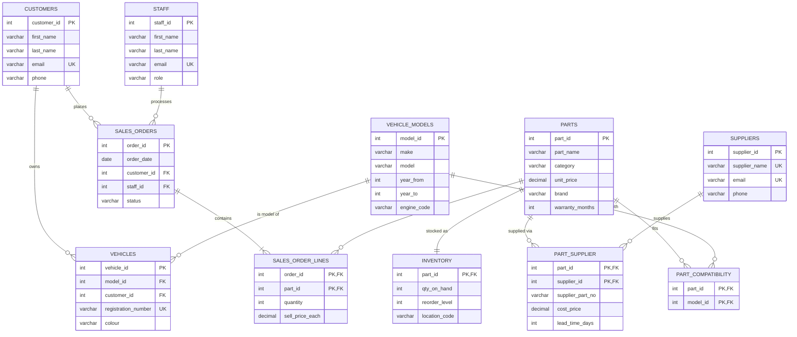

# AutoPartsPro: Sales & Inventory Database


A relational database for an auto parts store. It tracks customers and their vehicles, parts and stock, suppliers and their prices, and sales orders. It also answers the questions a store manager asks every week: **what sells, what makes money, what needs reordering, and which parts fit this customer's car.**

**Contents:**
[Overview](#overview) ·
[Design](#database-design) ·
[Reports](#business-reports) ·
[Findings](#findings-from-the-sample-data) ·
[Data integrity](#data-integrity) ·
[How to run](#how-to-run) ·
[Background](#background)

---

## Overview

| | |
|---|---|
| **Scenario** | An independent auto parts store on the Gold Coast, selling over the counter to car owners and trade customers |
| **Schema** | 11 tables in Third Normal Form, with named primary keys, foreign keys and CHECK constraints |
| **Sample data** | 10 customers, 12 vehicles, 8 vehicle models, 17 parts, 5 suppliers and 41 orders (Jul 2025 to Oct 2026) |
| **SQL** | Views, indexes, multi-table joins, subqueries, `HAVING`, CTEs and window functions (`RANK`, `ROW_NUMBER`, running totals) |
| **Testing** | 10 constraint tests that try to insert invalid data, and all 10 are rejected |

## Database design



### Design decisions

- **Historical prices are kept.** `SalesOrderLines.sell_price_each` stores the price actually charged. When `Parts.unit_price` changes, old orders keep their value, and trade discounts can be recorded.
- **Associative tables handle the many-to-many links.** A part can come from several suppliers at different costs and lead times (`PartSupplier`). It can also fit many vehicle models (`PartCompatibility`).
- **Inventory is a separate 1:1 table.** Stock levels change many times a day, while part details rarely do. Keeping them apart keeps the `Parts` table stable.
- **The rules live in the database, not just the app.** CHECK constraints guard prices, quantities, order statuses, staff roles, categories and model years. UNIQUE constraints stop duplicate emails and registration numbers.
- **`NULL` has a meaning.** `year_to IS NULL` means a model is still in production. A missing `phone` is allowed because email is the required contact.
- **Profit uses one shared definition.** The `PartCost` view takes the cheapest supplier cost for each part, and every profit figure is built on it. This means all reports agree.
- **Cancelled orders are not sales.** Every revenue and profit figure excludes them, while pending and in-progress orders count.
- **Table names are written the same way everywhere.** The schema runs on Linux servers, where MySQL table names are case-sensitive.

### Normalisation

The schema started as a single wide sales table and was normalised step by step to 3NF. The anomalies removed at each step are shown in [docs/normalisation.md](docs/normalisation.md).

## Business reports

All eight reports are in [`sql/04_reports.sql`](sql/04_reports.sql). Each one starts with the business question it answers.

| # | Question | SQL techniques |
|---|---|---|
| R1 | What is in each order, and what is it worth? | View, 4-table join, aggregation |
| R2 | Who are our most valuable customers? | `RANK()` window function |
| R3 | Which parts sell the most? | `GROUP BY` + `HAVING` |
| R4 | What needs reordering, from which supplier, and when will it arrive? | CTE + `ROW_NUMBER()`, date arithmetic |
| R5 | Which parts fit the car of the customer at the counter? | User variables, 5-table join, `CASE` |
| R6 | Which categories make the most profit? | CTE, margin %, share of total with `SUM() OVER ()` |
| R7 | How are sales tracking month by month? | CTE, running year-to-date total |
| R8 | Which stock has never sold, and how much cash is tied up in it? | `LEFT JOIN` / `IS NULL` anti-join |

### Example: R4, the reorder report

For each low-stock part, the report picks the best supplier (cheapest, then fastest) and tops stock back up to twice the reorder level. It also shows the cost and the expected arrival date. These results are from a run on 9 Nov 2026.

| part_name | qty_on_hand | reorder_level | suggested_order_qty | best_supplier | estimated_cost | expected_arrival |
|---|--:|--:|--:|---|--:|---|
| Front brake pad set | 4 | 15 | 26 | Southern Cross Brakes | 1,216.02 | 2026-11-12 |
| Oil filter | 12 | 40 | 68 | Metro Filters & Fluids | 427.04 | 2026-11-11 |
| Timing belt kit | 1 | 3 | 5 | Pacific Parts Distribution | 657.00 | 2026-11-19 |
| Coolant concentrate 5L | 6 | 10 | 14 | Sunshine Cooling Supplies | 349.72 | 2026-11-12 |

### Example: R5, the compatibility search

A customer with rego `784QRB` needs brake parts:

| vehicle | part_name | brand | unit_price | qty_on_hand | availability |
|---|---|---|--:|--:|---|
| Toyota HiLux (2015-now) | Front brake disc rotor | DBA | 129.00 | 6 | In stock |
| Toyota HiLux (2015-now) | Front brake pad set | Bendix | 89.95 | 4 | In stock |
| Toyota HiLux (2015-now) | Rear brake pad set | Bendix | 74.95 | 11 | In stock |
| Toyota HiLux (2015-now) | Brake fluid DOT 4 500ml | Castrol | 19.95 | 38 | In stock |

### Example: R6, profit by category

| category | revenue | gross_profit | margin_pct | share_of_revenue_pct |
|---|--:|--:|--:|--:|
| Braking | 2,180.80 | 1,013.60 | 46.5 | 39.8 |
| Filters | 860.81 | 467.29 | 54.3 | 15.7 |
| Electrical | 1,245.00 | 398.40 | 32.0 | 22.7 |
| Cooling | 808.73 | 381.17 | 47.1 | 14.7 |
| Engine | 389.35 | 179.74 | 46.2 | 7.1 |

## Findings from the sample data

- **Braking drives the business.** It brings in 40% of revenue and 42% of gross profit. Overall, $5,484.69 of sales produced $2,440.20 of gross profit, a 44.5% margin.
- **Filters have the best margin (54%).** They are cheap, fast-moving items that are worth keeping well stocked.
- **Electrical has the lowest margin (32%).** Batteries sell for a high price but cost a lot to buy in, so they add revenue but little profit.
- **The reports check each other.** R4 recommends reordering 5 timing belt kits, but R8 shows that none has sold in 16 months. A manager should lower that part's reorder level instead of spending $657.
- **$1,301 is tied up in dead stock.** It is spread across 4 parts. The shock absorbers and headlight globes are candidates for a promotion or a return to the supplier.

## Data integrity

[`tests/constraint_tests.sql`](tests/constraint_tests.sql) tries to break the business rules on purpose. All 10 attempts are rejected by the database:

| Test | Invalid action | Rejected by |
|---|---|---|
| T1 | Part with a negative price | `chk_parts_price` |
| T2 | Category "Groceries" | `chk_parts_category` |
| T3 | Stock below zero | `chk_inventory_qty` |
| T4 | Order status "shipped" | `chk_order_status` |
| T5 | Order for a customer who doesn't exist | `fk_order_customer` |
| T6 | Same part twice on one order | composite primary key |
| T7 | Order line with quantity 0 | `chk_line_qty` |
| T8 | Two customers with the same email | `UNIQUE (email)` |
| T9 | Model that ends before it starts | `chk_model_years` |
| T10 | Deleting a part that has stock and sales | foreign keys |

## How to run

**MySQL Workbench:** open and run each file in order (lightning-bolt icon):

1. `sql/01_schema.sql` creates the `AutoPartsPro` database and its tables
2. `sql/02_seed_data.sql` loads the sample data
3. `sql/03_views_indexes.sql` adds the views and indexes
4. `sql/04_reports.sql` runs the eight reports (each result opens in its own tab)

**Command line:**

```bash
mysql -u root -p < sql/01_schema.sql
mysql -u root -p < sql/02_seed_data.sql
mysql -u root -p < sql/03_views_indexes.sql
mysql -u root -p --table < sql/04_reports.sql

# optional: every statement in this file should fail
mysql -u root -p --force AutoPartsPro < tests/constraint_tests.sql
```

## Project structure

```
auto-parts-sales-database/
├── sql/
│   ├── 01_schema.sql           # tables, keys and constraints
│   ├── 02_seed_data.sql        # realistic sample data
│   ├── 03_views_indexes.sql    # PartCost, OrderSummary, DailySalesSummary + indexes
│   └── 04_reports.sql          # 8 business reports (R1-R8)
├── tests/
│   └── constraint_tests.sql    # 10 tests that must fail
├── docs/
│   └── normalisation.md        # 1NF -> 2NF -> 3NF walkthrough
└── README.md
```

## Ideas for next steps

- A transaction (or stored procedure) that places an order and reduces stock in one step, rolling back if stock is too low
- Database users with limited permissions (`GRANT`): for example, sales staff can read parts but cannot change prices
- A Power BI or Python dashboard built on the `DailySalesSummary` and `OrderSummary` views

## Background

This project began as my final assessment for **1814ITC Data Management** (Diploma of Information Technology, Griffith College, January 2026). In that assessment I designed the ERD, normalised it to 3NF and wrote the core queries.

In November 2026 I extended it into this portfolio version:
- replaced the random sample data with a realistic dataset
- added supplier cost and profit logic
- added window-function reports and constraint tests
- fixed the table-name case issue so the scripts run on Linux servers

All people, emails, phone numbers and registration numbers are fictional.

---

**Maria Pupysheva**, Bachelor of Computer Science student, Griffith University · [LinkedIn](https://www.linkedin.com/in/maria-pupysheva) · [GitHub](https://github.com/marusiyp)
